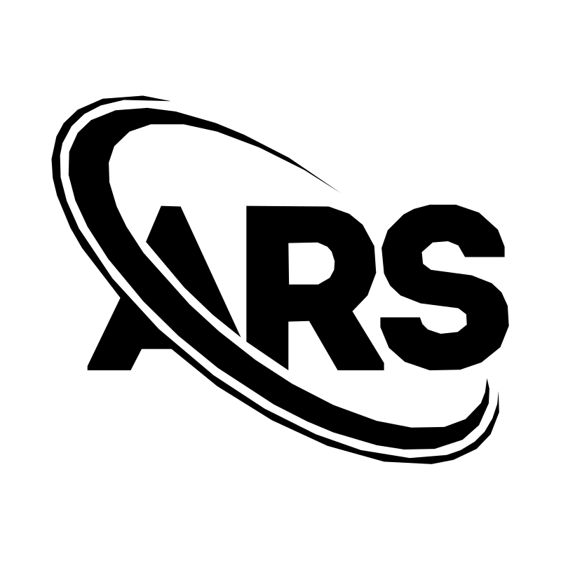
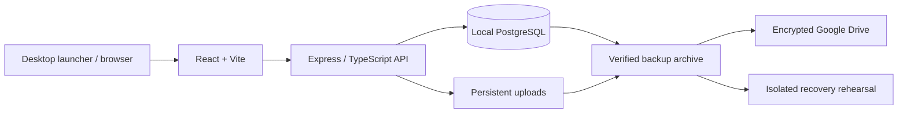

<div align="center">



# ARS Distributors

**Wholesale, inventory & distribution management**

Developed by **RS Nextward**


[](https://github.com/Rashid-RG/hardware-shop-pos-and-inventory/actions/workflows/ci.yml)


[Features](#business-capabilities) · [Installation](#installation) · [Architecture](#architecture) · [Release readiness](#release-readiness) · [Documentation](#documentation)

</div>

> **Release channel: shop-opening pilot.** This repository contains development and acceptance builds, not an approved commercial release. Successful CI does not replace physical installation, printer, accounting and recovery acceptance.

## Overview

ARS Distributors is a local-first business management application designed for wholesale importers and distributors. It brings sales, warehouse stock, purchasing, customer credit, supplier accounts and financial operations into one system. The desktop installation targets Windows and Linux Mint Cinnamon, with PostgreSQL running locally so normal billing does not depend on a hosted service.

## Business capabilities

| Area | Scope |
| --- | --- |
| Wholesale sales | Quotations, invoices, custom prices, credit sales and sales representatives |
| Inventory | Box and piece units, product images, stock movements and availability checks |
| Procurement | Purchase orders, import shipments, warehouse receiving and landed costs |
| Accounts | Customer and supplier balances, receipts, payments, returns, cash and bank operations |
| Financial management | Ledger workflows, payroll, statutory contributions, partner capital and profit allocation |
| Reporting | PDF, Excel and CSV exports; custom 24 × 27 cm continuous-feed invoices |
| Administration | Role-based access, first-administrator setup, password recovery and maintenance controls |
| Data protection | Local backup, archive checksums, encrypted Google Drive support and isolated restore |

These describe the intended pilot scope; individual workflows still require the acceptance checks below.

## Architecture



| Layer | Technology |
| --- | --- |
| Frontend | React, TypeScript, Vite, Tailwind CSS |
| Backend | Node.js 22, Express, TypeScript |
| Database | PostgreSQL, local Docker runtime |
| Desktop & maintenance | PowerShell / native Windows supervisor; Linux Mint shell and Python utilities |
| Verification | Node test runner, PostgreSQL integration checks, GitHub Actions |
| Packaging | Windows EXE, Linux Mint DEB and pilot archives through CI |

## Installation

**Use a disposable test computer or isolated installation first.** Do not overwrite an existing installation or enter real business records until the release is approved.

### Windows and Linux Mint

Pilot installer artifacts are produced by successful packaging workflows. Open [GitHub Actions](https://github.com/Rashid-RG/hardware-shop-pos-and-inventory/actions/workflows/ci.yml), select a successful run for the development branch, and review its artifacts and exact commit. These are not signed-off production releases.

- **Windows:** native EXE is the intended installer path. Docker Desktop must support Linux containers. Existing installations must use protected maintenance procedures rather than fresh setup.
- **Linux Mint Cinnamon:** native DEB is the intended installer path. Local Docker Engine and Compose v2, Node.js 22, Python 3, Zenity and desktop utilities are required. The source installer `bash scripts/mint/install.sh` is only for fresh installations; do not rerun it to update a shop.

Physical dependency installation, reboot, launch and offline operation must be verified on both target systems.

### Developer setup

Use Node.js 22, npm and a **dedicated test PostgreSQL database**. Configure a private local environment from the repository example only for a fresh test installation. Never overwrite existing configuration.

```sh
npm ci
npm run dev
```

For validation:

```sh
npm run lint
npm test
npm run build
```

A prepared production build can run using `npm start` with the correct private runtime configuration. Do not run it alongside another writer connected to the same database.

## Data protection and maintenance

- Keep the database volume, business configuration, uploads and recovery archives intact.
- Back up both PostgreSQL and uploaded files; verify archive checksums and rehearse restoration in isolation.
- Configure encrypted Google Drive backups on the actual machine and store recovery keys separately.
- Signed update preparation and protected recovery are under development. **Live candidate activation and automatic live rollback are not approved.**
- Never remove maintenance holds or unresolved recovery evidence manually, overwrite production with a test restore, or delete database volumes to resolve a software issue.

### Windows Docker recovery rehearsal

Only on a dedicated Windows test machine with Docker Desktop in Linux-container mode and dependencies installed, run:

```powershell
.\scripts\rehearse-windows-docker-maintenance-recovery.ps1
```

The rehearsal uses disposable sample databases, builds a temporary maintenance supervisor, and refuses to proceed if either managed container name is occupied. A successful result is test evidence only.

## Release readiness

| Gate | State |
| --- | --- |
| Application build and automated validation | See current CI badge and workflow results |
| Windows / Linux Mint packaging | CI-generated pilot artifacts |
| Installed update and rollback | Development and rehearsal; live activation locked |
| Physical installation and reboot | Acceptance required |
| Custom invoice printer and operator testing | Acceptance required |
| Financial reconciliation | Owner/accountant review required |
| Encrypted backup and full recovery | Target-machine configuration and acceptance required |
| Commercial activation | Explicit owner approval required |

Use the [V1.0 shop-opening acceptance record](docs/v1-shop-opening-acceptance.md) to record exact release commit, device, tester and observed results. Do not infer readiness from the version number or a green badge.

## Documentation

| Document | Purpose |
| --- | --- |
| [V1.0 acceptance](docs/v1-shop-opening-acceptance.md) | Authoritative shop-opening release gates |
| [Backup rollout](docs/ars-backup-rollout.md) | Backup and recovery operations |
| [Customer and staff acceptance](docs/ars-customer-staff-acceptance.md) | Operator verification |
| [Warehouse staff acceptance](docs/ars-warehouse-staff-acceptance.md) | Warehouse workflow verification |
| [Database handoff](docs/database-version-handoff.md) | Database writer coordination |
| [Low-scroll UX standard](docs/ars-low-scroll-ux-standard.md) | Application design principles |
| [Original blueprint](docs/original-development-blueprint.md) | Historical planning only; proposed stack migration is outside V1.0 |

Older Windows, hosted and production checklist documents may describe historical installation steps or A4 printing. Use the V1.0 acceptance record and current implementation for the local pilot.

## Security and contributions

Use the development branch `codex/shop-opening-pilot` for pilot changes. Keep credentials, customer records, recovery keys, private environment files and database backups out of commits, issues, screenshots and CI output. Report suspected security vulnerabilities privately through the repository's maintainers rather than posting sensitive details in a public issue.

No software license is currently declared in this repository. Public visibility does not by itself grant permission to redistribute or commercially reuse the software.

---

<div align="center">

**RS Nextward** · ARS Distributors

Wholesale & Distribution Management System

</div>
